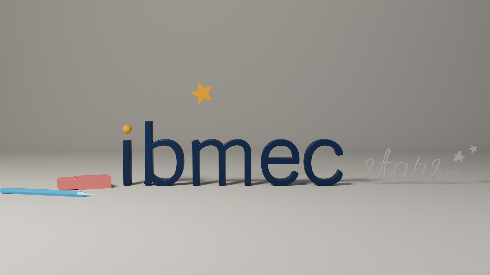
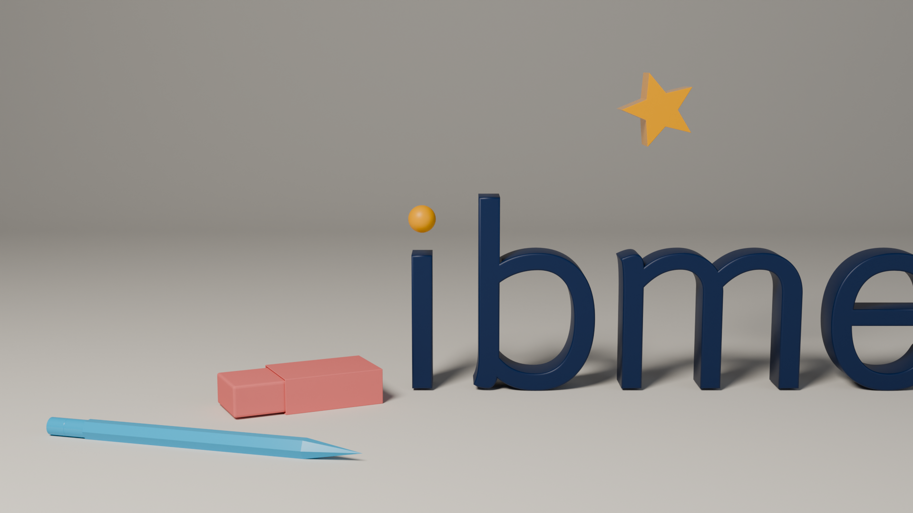

# AC04 — Modelos de Iluminação

**Aluno:** Marceu Veiga de Almeida Filho  
**Ferramenta:** Blender 4.5 LTS, com Python integrado.  
**Base:** cópia da cena da [AP1](../AP1/README.md) — a AP1 não foi alterada.

## Arquivos

- [AC04_MarceuFilho.blend](AC04_MarceuFilho.blend): cena com luzes e os três materiais.
- [AC04_MarceuFilho.py](AC04_MarceuFilho.py): script que parte da AP1 e monta esta etapa.
- [AC04_MarceuFilho_render.png](AC04_MarceuFilho_render.png): cena final, câmera `CAM_Principal`.
- [AC04_MarceuFilho_comparacao.png](AC04_MarceuFilho_comparacao.png): os três materiais sob a mesma luz, câmera `CAM_Comparacao`.

## Objetos e materiais

| Objeto autoral | Material | Cor base (RGB linear) | Roughness | Specular IOR Level |
| --- | --- | --- | --- | --- |
| Borracha (`Borracha_Corpo`, `Borracha_Capa`) | `MAT_Lambert` | (0,80; 0,22; 0,22) | 1,0 | 0,0 |
| Lápis (`Lapis_Corpo` e peças) | `MAT_Phong` | (0,03; 0,45; 0,80) | 0,2 | 0,5 |
| Estrela (`Obj_Estrela`) | `MAT_BlinnPhong` | (0,913; 0,413; 0,0) | 0,1 | 1,0 |

A palavra **Ibmec** ficou fora da comparação e recebeu as cores oficiais do logotipo (SVG do site ibmec.br): letras em azul `#002555` (`MAT_Ibmec`) e pingo do “i” em amarelo `#F5AC00` (`MAT_Ibmec_Pingo`).

## Iluminação

As posições abaixo usam o sistema da cena: *u* ao longo da palavra, *n* para a frente (lado da câmera) e *z* para cima, em metros.

| Luz | Tipo | Posição (u; n; z) | Potência | Tamanho | Cor |
| --- | --- | --- | --- | --- | --- |
| `LUZ_Principal` | Area (disco) | (−2,2; 2,6; 3,0) | 160 W | 1,5 m | branco quente (1,0; 0,93; 0,82) |
| `LUZ_Preenchimento` | Area (disco) | (3,0; 3,0; 1,4) | 35 W | 4,0 m | branco frio (0,82; 0,90; 1,0) |

As duas apontam para o centro da palavra. O ambiente (`World`) é azul-claro com força 0,12. Foi criado o fundo infinito `Cenario_Fundo`, um chão que sobe em curva até virar parede. Luzes, câmeras e enquadramento são os mesmos nas duas imagens. Render em Cycles, 128 amostras, AgX.

## Comparação

- **Lambert (borracha):** só reflexão difusa. O tom muda aos poucos conforme a face se afasta da luz e não há ponto de brilho. A superfície parece fosca, como borracha.
- **Phong (lápis):** além da difusa, aparece uma faixa de brilho especular ao longo do corpo. O brilho é concentrado e segue a direção da luz principal.
- **Blinn-Phong (estrela):** com rugosidade menor e especular mais forte, as faces refletem o ambiente com mais nitidez e as bordas chanfradas ganham brilhos pequenos e intensos. É a superfície mais polida das três.

O brilho especular depende do ângulo entre a luz, a superfície e o observador: ao mover a luz principal, o brilho do lápis e da estrela muda de lugar, enquanto a borracha só fica mais clara ou mais escura, porque a reflexão difusa depende apenas do ângulo entre a luz e a superfície.

## Limitação

O Principled BSDF do Blender 4.5 é baseado em princípios físicos (microfacetas e conservação de energia). Ele **não implementa literalmente** as equações de Phong e de Blinn-Phong. Os materiais `MAT_Phong` e `MAT_BlinnPhong` são aproximações visuais, obtidas com os controles de rugosidade e de Specular IOR Level, para comparar os comportamentos.
