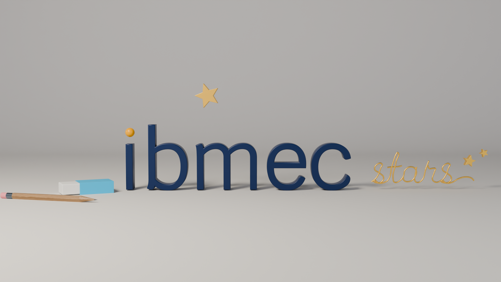
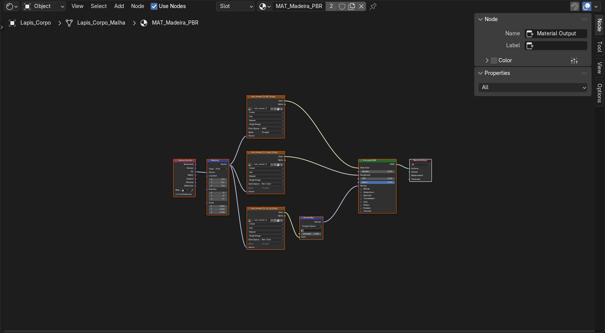
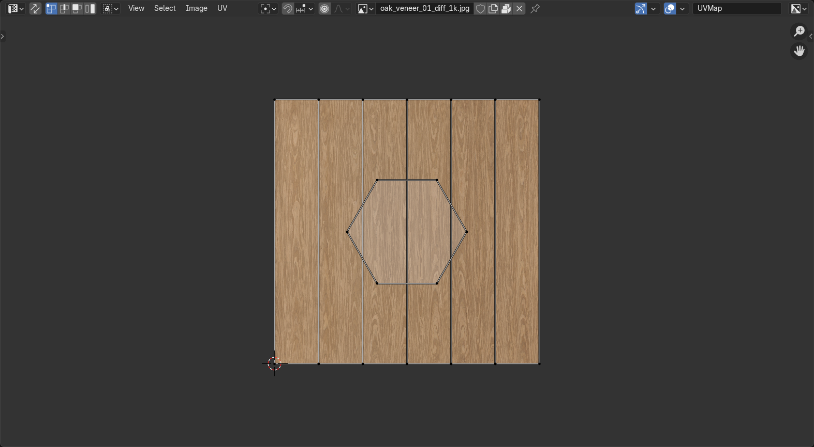

# AC05 — Materiais PBR e Texturas

**Aluno:** Marceu Veiga de Almeida Filho  
**Ferramenta:** Blender 4.5 LTS, com Python integrado.  
**Base:** cópia da cena da [AC04](../AC4/README.md) — a AP1 e a AC04 não foram alteradas.

## Arquivos

- [AC05_MarceuFilho.blend](AC05_MarceuFilho.blend): cena com materiais PBR e texturas empacotadas.
- [AC05_MarceuFilho.py](AC05_MarceuFilho.py): script que parte da AC04 e monta esta etapa.
- [AC05_MarceuFilho_render.png](AC05_MarceuFilho_render.png): render da câmera principal.
- [AC05_MarceuFilho_detalhe.png](AC05_MarceuFilho_detalhe.png): detalhe dos três objetos.
- [AC05_UV_Lapis_Corpo.svg](AC05_UV_Lapis_Corpo.svg) e [AC05_UV_Obj_Estrela.svg](AC05_UV_Obj_Estrela.svg): mapas UV exportados.
- [AC05_ShaderEditor_Madeira.png](AC05_ShaderEditor_Madeira.png): captura do Shader Editor (`MAT_Madeira_PBR`).
- [AC05_UVEditor_Lapis.png](AC05_UVEditor_Lapis.png): captura do UV Editor (`Lapis_Corpo`).
- [texturas/](texturas/): imagens originais (também empacotadas no `.blend`).

## Objetos e materiais

Todos usam o Principled BSDF. Os materiais Lambert, Phong e Blinn-Phong da AC04 foram substituídos.

| Objeto autoral | Aparência | Material | Base Color | Roughness | Metallic |
| --- | --- | --- | --- | --- | --- |
| Lápis — corpo e ponta de madeira | **madeira** | `MAT_Madeira_PBR` | imagem | imagem | 0 |
| Lápis — ferrule | **metal** | `MAT_Metal_Escovado` | imagem | imagem | 1 |
| Lápis — grafite / borrachinha | — | `MAT_Grafite` / `MAT_Borracha_Rosa` | cor sólida | 0,35 / 0,8 | 0,6 / 0 |
| Estrela | **metal** dourado | `MAT_Ouro_PBR` | (1,0; 0,62; 0,12) | imagem | 1 |
| Borracha — corpo | borracha fosca | `MAT_Borracha_PBR` | (0,88; 0,87; 0,83) | 0,8 | 0 |
| Borracha — capa | papel | `MAT_Capa_Papel` | (0,04; 0,53; 0,84) | 0,6 | 0 |
| Palavra Ibmec | plástico acetinado | `MAT_Ibmec_PBR` | azul `#002555` | 0,35 | 0 |
| Pingo do “i” | plástico acetinado | `MAT_Ibmec_Pingo_PBR` | amarelo `#F5AC00` | 0,35 | 0 |

A marca não recebeu textura nem relevo. As cores são as do logotipo oficial.

## Mapas e conexões

`MAT_Madeira_PBR` demonstra os três canais:

- **Base Color** (`oak_veneer_01_diff_1k.jpg`, sRGB) → entrada `Base Color`.
- **Roughness** (`oak_veneer_01_rough_1k.jpg`, Non-Color) → entrada `Roughness`.
- **Normal** (`oak_veneer_01_nor_gl_1k.jpg`, Non-Color) → nó `Normal Map` → entrada `Normal`.

Todos passam por `Texture Coordinate (UV)` → `Mapping` (escala 0,5; 0,5).

`MAT_Metal_Escovado` usa cor, rugosidade e normal do `Metal032`. `MAT_Ouro_PBR` usa cor sólida dourada, com a rugosidade e a normal (força 0,3) do mesmo metal, para ter riscos finos. `MAT_Borracha_PBR` é procedural: um `Noise Texture` (escala 400) ligado a um nó `Bump` (força 0,15) dá a textura fosca da borracha.

## UV

- **Lápis (corpo, madeira e ferrule):** projeção cilíndrica em torno do eixo do lápis, calculada no script (`uv_cilindrico`): U é o ângulo e V é a altura. Os veios da madeira acompanham o comprimento do lápis. As faces que cruzam a emenda recebem U + 1 para não esticar a textura, e as tampas usam projeção plana.
- **Estrela:** `Smart UV Project` (limite de 66°, margem 0,02), que separa frente, verso e laterais em ilhas sem distorção.
- A escala foi ajustada no nó `Mapping` até os veios ficarem com tamanho coerente com o lápis.

## Iluminação

Luzes e câmera são as da AC04. Mudança registrada: o ambiente passou a usar o HDRI de estúdio `studio_small_08` com força 0,25. Sem ele os metais refletiam um fundo liso e pareciam plástico; com ele a estrela e o ferrule mostram reflexos reais. A rugosidade da madeira aparece como um brilho suave e irregular sob a luz principal.

## Fontes e licenças

| Recurso | Fonte | Licença |
| --- | --- | --- |
| `oak_veneer_01` (cor, rugosidade, normal, 1K) | [Poly Haven](https://polyhaven.com/a/oak_veneer_01) | CC0 |
| `studio_small_08` (HDRI, 1K) | [Poly Haven](https://polyhaven.com/a/studio_small_08) | CC0 |
| `Metal032` (cor, rugosidade, normal, 1K) | [ambientCG](https://ambientcg.com/view?id=Metal032) | CC0 |
| Fonte Krub Regular (palavra Ibmec, desde a AP1) | Google Fonts / Cadson Demak | SIL Open Font License |
