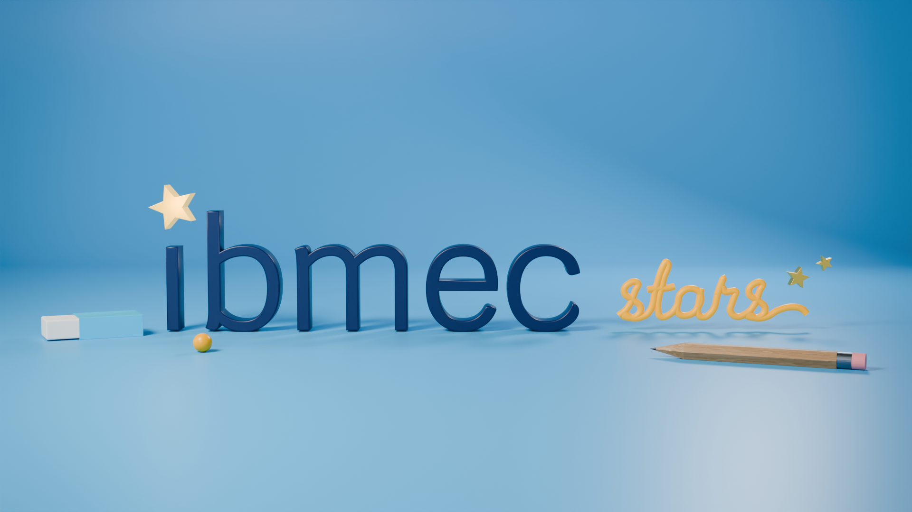
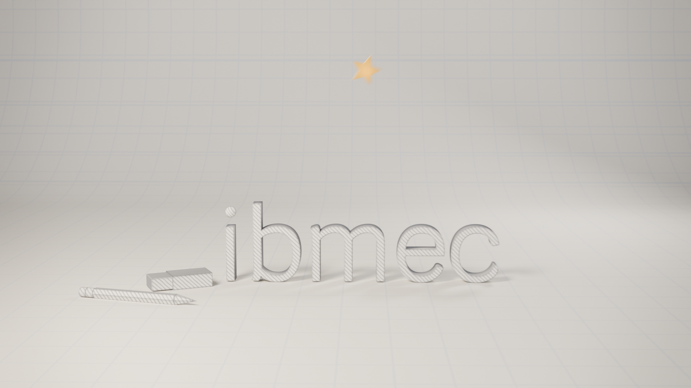
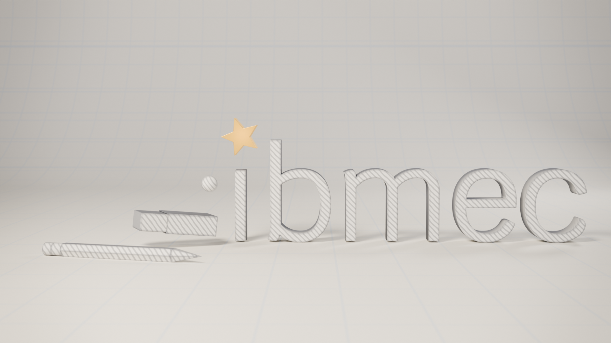
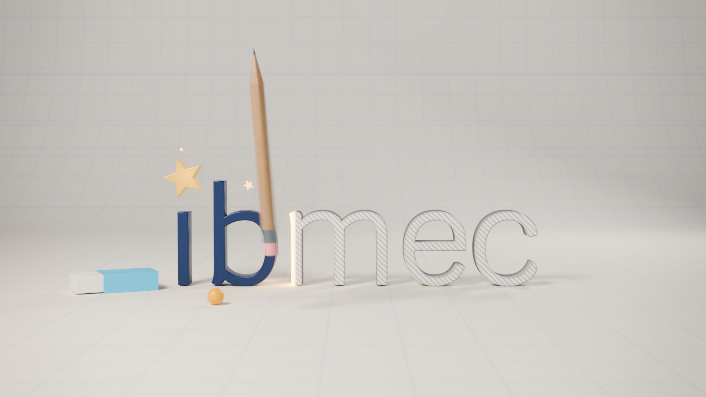
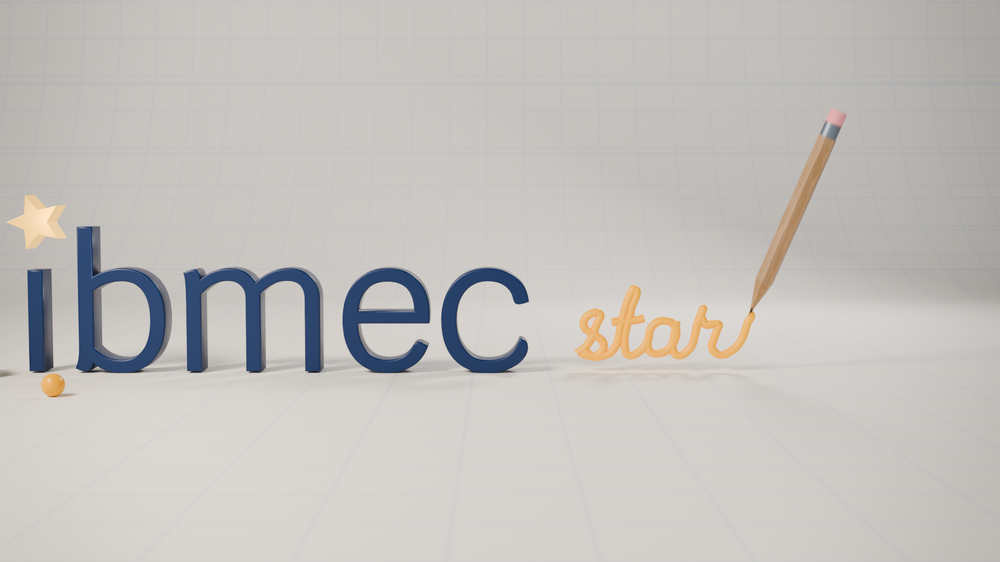
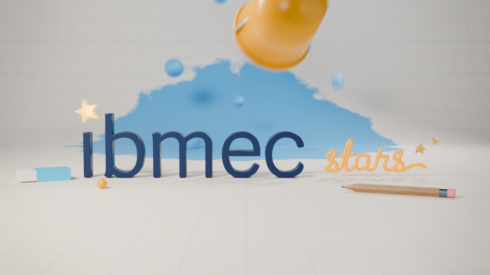

# AP2 — Ibmec Stars: uma ideia vira estrela

**Aluno(a):** Marceu Veiga de Almeida Filho  
**Matrícula:** 202051772191  
**Curso / Turma:** Engenharia de software — 8001  
**Software:** Blender 4.5 LTS (Cycles), com scripts em Python  
**Base:** cópia da cena da [AC05](../AC5/README.md), que veio da [AC04](../AC4/README.md) e da [AP1](../AP1/README.md). 

## Entregáveis

| Arquivo | Conteúdo |
| --- | --- |
| [AP2_MarceuFilho.blend](AP2_MarceuFilho.blend) | Cena, animação, materiais, texturas empacotadas, luzes, câmera e saída |
| [AP2_MarceuFilho.mp4](AP2_MarceuFilho.mp4) | Vídeo final: 15 s, 24 fps, 1920×1080, H.264 |
| [render-final.png](render-final.png) | Quadro final (frame 360) |
| [storyboard-ap2-1.png](storyboard-ap2-1.png) a [storyboard-ap2-5.png](storyboard-ap2-5.png) | Storyboard atualizado, com quadros do render |
| [AP2_MarceuFilho.py](AP2_MarceuFilho.py) | Script que parte da AC05 e monta a animação |
| [renderizar.py](renderizar.py) | Script do render final e da montagem do vídeo |

## 1. Título, conceito e resumo

**Título:** Ibmec Stars: uma ideia vira estrela.

**Conceito:** o mesmo da AP1. Uma estrela, uma borracha e um lápis dão vida à palavra Ibmec. Aprender é trocar o ponto final por uma ideia nova, corrigir, tentar de novo e assinar o resultado. Nesta versão a cena começa como um **desenho a lápis** numa folha de caderno: só a estrela (a ideia) tem cor. É o lápis que leva a cor ao resto.

**Resumo:** uma estrela dourada cai como um meteoro e toma o lugar do pingo do “i”. O pingo cai, quica na borracha e rola pelo chão. O lápis acorda e ganha cor, fica em pé e atravessa a cena aos pulos; tudo por onde ele passa deixa de ser desenho e ganha cor, letra por letra. A estrela acende quando o lápis passa por ela. No fim ele escreve “stars” ao lado da marca, e um balde de tinta vem de trás da câmera e pinta o fundo de azul-claro, para a marca e a estrela se destacarem. Duas estrelinhas surgem e a composição final diz “ibmec stars”.

A palavra Ibmec não se move em nenhum momento. Ela começa desenhada (papel branco, hachuras e contorno de grafite, sempre legível) e termina com as cores oficiais do logotipo: letras em azul `#002555` e pingo em amarelo `#F5AC00`. No logotipo o pingo já é amarelo; por isso a estrela dourada no lugar dele continua a identidade da marca.

## 2. Planos e ações

| Plano | Tempo / frames | Ação | Câmera |
| --- | --- | --- | --- |
| 1 — A estrela chega | 0–3 s / 1–76 | A cena fica calma. No frame 42 a estrela entra pelo alto, à direita, e desce girando como um meteoro, sem parar, acelerando até acertar o pingo. Só ela tem cor; o resto é desenho. | Aberta e alta, para mostrar a queda inteira. |
| 2 — Troca de lugar | 3–6 s / 76–144 | A estrela derruba o pingo e toma o lugar dele, passando um pouco do ponto e voltando. O pingo é jogado na borracha, quica nela e no chão, e rola até parar. A borracha afunda e dá um pulinho. | Aproxima junto com o impacto e acompanha o pingo. |
| 3 — Levanta, quica e gira | 6–10 s / 145–240 | O lápis se mexe e a cor sobe por ele, da borracha à ponta. Fica em pé e dá três saltos inclinados, da esquerda para a direita. Uma faixa dourada acompanha o lápis e colore a borracha, o pingo e as letras i-b-m-e-c, com pequenas faíscas. | Desliza para a direita com o lápis. |
| 4 — Uma assinatura mágica | 10–13 s / 241–311 | O lápis sobe, vira a ponta para baixo e escreve “stars” em três traços (248–304). Surgem duas estrelinhas e a estrela principal dá um giro. | Acompanha a escrita. |
| 5 — O balde | 13–15 s / 312–360 | O lápis deita. Um balde amarelo entra por cima, vindo de trás da câmera, inclina e joga a tinta (326–330); gotas azuis voam até o fundo e a mancha se espalha por todo o cenário (333–347). O balde recua por onde veio. Pausa final para leitura (347–360). | Abre para a composição final; o diafragma fecha (f/2,8 → f/11) para o balde ficar nítido. |

**Storyboard atualizado**

| | |
| --- | --- |
|  |  |
|  |  |
|  | |

Mudanças em relação ao storyboard da AP1: a estrela não paira mais sobre o pingo: desce de uma vez e o derruba; o pingo quica **em cima** da borracha antes de cair no chão; a cena começa como desenho e ganha cor com a passagem do lápis (a AP1 era cinza); o encerramento ganhou o balde que pinta o fundo de azul; e “stars” é escrito no ar, no plano da palavra, como na modelagem da AP1.

## 3. Propriedades animadas, timing e interpolação

Para deixar os números simples, os objetos animados são filhos do vazio `Palco`, alinhado com a palavra: X corre ao longo da palavra, Y é a profundidade e Z é a altura. As rotações foram passadas de quaternion para Euler, para as curvas ficarem legíveis no Graph Editor.

| Elemento | Propriedades | Interpolação e motivo |
| --- | --- | --- |
| `Obj_Estrela` | posição, rotação Z, escala | Queda de meteoro em um só movimento (frames 42–76): X `Linear` e Z `Quad / Ease In`, o que dá uma curva que fica mais íngreme e mais rápida até o impacto. Giro `Linear` de uma volta e meia. Ao bater, passa do ponto, amassa e volta. `Back / Ease Out` no giro final, que passa um pouco do ponto e volta. A emissão do material (`MAT_Estrela_Ouro`) e a potência da `LUZ_Estrela` sobem nos frames 196–205, quando o lápis passa, e assentam num brilho constante. |
| `Marca_Pingo` | posição, escala | Saltos: X e Y `Linear`; Z com `Quad / Ease Out` na subida e `Quad / Ease In` na descida, formando parábolas. Cada salto é mais baixo e mais curto que o anterior. `Sine / Ease Out` na rolagem final. |
| `Borracha_Corpo` | posição, rotação, escala | Afunda (escala Z 0,72), salta e assenta. Bézier, com o mesmo arco de salto do pingo. |
| `CTRL_Lapis` (pai do lápis) | posição, rotação, escala | `Back / Ease Out` ao levantar (passa do ponto e volta). Saltos em parábola, com agachar e esticar na escala. Em cada salto o lápis se inclina (rotação Y): recua ao agachar (−10°), joga o corpo para onde vai (32°) e freia ao cair (−16°). O giro em torno do próprio eixo fica no `Lapis_Corpo`, `Linear`, uma volta por salto. `Linear` na escrita, com um keyframe a cada 2 frames sobre a curva. `Bounce / Ease Out` ao deitar. |
| `Texto_Stars_1/2/3` | `bevel_factor_end` da curva (0 → 1) | `Linear`: o traço cresce em velocidade constante, junto com a ponta do lápis. |
| `Estrela_Decorativa_01/02` | escala (0 → tamanho final), rotação | `Back / Ease Out`: surgem com um pequeno exagero. |
| `MAT_Stars_Ouro` | força da emissão | Bézier: sobe ao terminar a assinatura e assenta num brilho menor. |
| `Magia_Frente` | posição X | `Linear`, com os mesmos frames dos saltos: a fronteira da cor anda junto com o lápis. Fica fora da cena antes do frame 176 e depois do 240. |
| `Magia_Lapis` (filho do `CTRL_Lapis`) | posição ao longo do lápis | `Linear`, frames 148–172: a cor corre da borracha até o grafite. |
| `Faisca` (12 estrelinhas) | escala, posição Z, rotação | `Back / Ease Out`: surgem, sobem um pouco e somem em 16 frames. |
| `Balde_Tinta` | posição, rotação | Bézier na entrada; `Quad / Ease In` no arremesso (frames 326–330); volta por cima até o frame 346. |
| `Tinta_Gota` (7 gotas) | posição, escala | Mesmo arco de salto do pingo; somem ao tocar a mancha. |
| `Tinta_Centro` | escala (raio da mancha, 0 → 14) | `Quad / Ease Out`, frames 333–347: a tinta avança depressa e desacelera. |
| `CAM_Principal` (lente) | abertura f/2,8 → f/11 | Bézier, frames 300–318. |
| `CAM_Principal` e `CAM_Alvo` | posição (9 keyframes cada) | Bézier. A câmera segue o alvo com a constraint **Track To**. |

**Princípios usados:** antecipação (o lápis se mexe antes de levantar e recua antes de cada salto), amassar e esticar (pingo, estrela, borracha e lápis), arcos (todos os saltos), aceleração e desaceleração, ação secundária (a borracha reage ao pingo) e exagero.

**Timing:** cada plano tem uma ação principal. As ações rápidas (queda da estrela, 34 frames; pingo derrubado até a borracha, 12 frames; saltos do lápis, 16 frames cada) alternam com pausas curtas. A assinatura leva 56 frames. Os últimos 13 frames ficam parados para a leitura de “ibmec stars” sobre o fundo azul.

## 4. Iluminação e renderização

Iluminação de três pontos, pensada para as letras azul-escuras se destacarem do fundo claro. Posições no sistema do `Palco` (X; Y; Z), em metros; Y negativo é o lado da câmera.

| Luz | Tipo | Posição | Potência | Função |
| --- | --- | --- | --- | --- |
| `LUZ_Principal` | Area, disco de 1,5 m, quente | (−2,2; −2,6; 3,0) | 200 W | Luz principal, à esquerda e acima: dá volume e sombras suaves para a direita. |
| `LUZ_Preenchimento` | Area, disco de 4 m, fria | (3,0; −3,0; 1,4) | 22 W | Clareia as sombras sem criar uma segunda sombra forte. |
| `LUZ_Contorno` | Area, disco de 1 m | (2,2; 2,6; 2,4) | 70 W | Fica atrás da palavra e separa de leve as letras do fundo. |
| `LUZ_Estrela` | Point, quente, filha da estrela | à frente da estrela | 0,12 W | Acompanha a estrela e ilumina de leve as letras por onde ela passa. |
| Ambiente | HDRI `studio_small_08` | — | força 0,25 | Reflexos nos metais e luz geral suave. |

As luzes principal e de preenchimento vêm da AC04, com a potência reajustada. O Principled BSDF é baseado em física; não descrevo os materiais como Phong ou Blinn-Phong.

**Render:** Cycles na GPU (OptiX, RTX 4090), 128 amostras com denoise, motion blur (obturador 0,4), 1920×1080, 24 fps, frames 1–360, AgX com o look *Medium High Contrast* e exposição +0,3. A câmera tem 50 mm, profundidade de campo em f/2,8 com foco no `CAM_Alvo`. No compositor, um nó **Glare** (Bloom) faz o brilho da assinatura e da faixa de cor, e uma vinheta suave (Ellipse Mask → Blur → Mix Multiply, fator 0,35) escurece um pouco os cantos. O render saiu como sequência de PNG e o vídeo foi montado no sequenciador do Blender em MP4 / H.264.

O plano da AP1 previa Eevee. Troquei para Cycles porque a máquina tem GPU adequada e o traçado de caminhos dá sombras suaves e reflexos corretos nos metais.

## 5. Materiais e texturas da AC05

Reaproveitados sem alteração: `MAT_Madeira_PBR` (lápis; cor base, rugosidade e normal), `MAT_Metal_Escovado` (ferrule), `MAT_Ouro_PBR` (estrela e estrelinhas), `MAT_Borracha_PBR`, `MAT_Capa_Papel`, `MAT_Grafite`, `MAT_Borracha_Rosa`, `MAT_Ibmec_PBR` e `MAT_Ibmec_Pingo_PBR`. Os mapas de cor estão em sRGB; rugosidade e normal estão em Non-Color, e as normais passam pelo nó Normal Map.

Ajustes para a sequência:

- **Do desenho para a cor.** Os materiais da palavra, do pingo, da borracha e do lápis continuam sendo os da AC05, mas a saída de cada um passa por uma mistura (`Mix Shader`) com um segundo Principled BSDF chamado `Desenho`: papel branco, hachuras diagonais (`Wave Texture`), borda escura (`Layer Weight`) e traço nas arestas (nó `Bevel` comparado com a normal real). O fator da mistura vem da posição de um vazio (`Texture Coordinate > Object`): à esquerda dele vale o material PBR, à direita vale o desenho. Na fronteira, um `Emission` dourado faz a faixa brilhante. A estrela não tem essa mistura.
- `MAT_Fundo`: virou folha de caderno — papel claro com grão fino (`Noise` → `Bump`) e uma grade azul discreta a cada 25 cm, alinhada com a palavra; rugosidade 0,75.
- `MAT_Faisca` (novo, cópia de `MAT_Ouro_PBR` com emissão) para as faíscas.
- `MAT_Estrela_Ouro` (novo, cópia de `MAT_Ouro_PBR` com emissão animada) só na estrela principal.
- **Tinta no fundo.** `MAT_Fundo` mistura o papel com um azul-claro (RGB linear 0,09; 0,45; 0,85), mais liso que o papel (rugosidade 0,42). A máscara é a distância até o vazio `Tinta_Centro` (`Texture Coordinate > Object` → `Vector Math: Length`), somada a um `Noise Texture` para a borda ficar irregular. Só o cenário é pintado; a marca e os objetos mantêm suas cores.
- `MAT_Tinta`, `MAT_Balde` (amarelo do logotipo) e `MAT_Balde_Alca`: materiais simples do balde e das gotas. O balde é um **objeto auxiliar** novo (cone truncado, aro e alça com toros); os três objetos autorais continuam sendo a estrela, a borracha e o lápis.
- `MAT_Stars_Ouro` (novo, cópia de `MAT_Ouro_PBR`): passou a ser não metálico, com a cor amarela do logotipo e emissão animada. O metal refletia o fundo branco e a assinatura fina ficava pálida.
- Lápis 1,4× mais grosso (escala do `CTRL_Lapis`), para ser lido de longe. As UVs cilíndricas não distorcem porque o comprimento não mudou.
- A curva `Texto_Stars` foi dividida em três objetos, um por traço, e ficou mais espessa (bevel 0,014).

Todas as imagens estão empacotadas no `.blend`.

## 6. Desafios e soluções

- **Cena na diagonal.** A palavra da AP1 está girada cerca de 47° e os objetos usavam quaternions. O vazio `Palco` e a conversão para Euler deixaram os keyframes com números simples.
- **Escrever três traços em ordem.** O `bevel_factor` vale para todos os traços de uma curva ao mesmo tempo. Separei a curva em três objetos e animei um de cada vez.
- **Ponta do lápis sobre a linha.** O script percorre a curva Bézier, calcula pontos igualmente espaçados e posiciona o controle do lápis para a ponta tocar cada ponto.
- **Lápis atravessando o chão.** No primeiro teste ele virava a ponta para baixo ainda perto do chão. Agora sobe primeiro e só depois vira.
- **Imagem lavada.** A luz de contorno refletia no chão e o Bloom espalhava esse brilho sobre as letras. Reduzi a luz, aumentei a rugosidade do chão e subi o limiar do Glare.
- **Desenho pouco legível.** No primeiro teste a palavra branca sumia no papel. Escureci as hachuras e acrescentei o traço nas arestas para a marca ser lida também antes de ganhar cor.
- **Uma só animação para a cor.** Em vez de animar cada material, todos leem a posição do mesmo vazio (`Magia_Frente`), que segue o lápis.
- **Balde na frente da marca.** No primeiro teste o balde caía passando pela palavra. Agora ele recua por cima, por onde veio.
- **Balde desfocado.** Perto da câmera ele ficava borrado; animei a abertura da lente para f/11 no final.
- **Cor da marca.** Com a luz forte, o AgX clareava o azul. Ajustei as potências até o azul ficar próximo do `#002555`.

## 7. Fontes e licenças

| Recurso | Fonte | Licença |
| --- | --- | --- |
| Textura `oak_veneer_01` (1K) | [Poly Haven](https://polyhaven.com/a/oak_veneer_01) | CC0 |
| HDRI `studio_small_08` (1K) | [Poly Haven](https://polyhaven.com/a/studio_small_08) | CC0 |
| Textura `Metal032` (1K) | [ambientCG](https://ambientcg.com/view?id=Metal032) | CC0 |
| Fonte Krub Regular | Google Fonts / Cadson Demak | SIL Open Font License |
| Cores do logotipo Ibmec | SVG do site [ibmec.br](https://www.ibmec.br/) | marca do Ibmec, uso acadêmico |

Modelos, animação e scripts são autorais. Não há áudio.

## Como reproduzir

1. Abrir `AC5/AC05_MarceuFilho.blend` no Blender 4.5 LTS e executar `AP2/AP2_MarceuFilho.py` em *Scripting > Run Script*. O script salva `AP2/AP2_MarceuFilho.blend`.
2. Para renderizar: `blender -b AP2_MarceuFilho.blend --python renderizar.py`, ou *Render > Render Animation* (a saída já está configurada para MP4 / H.264).
